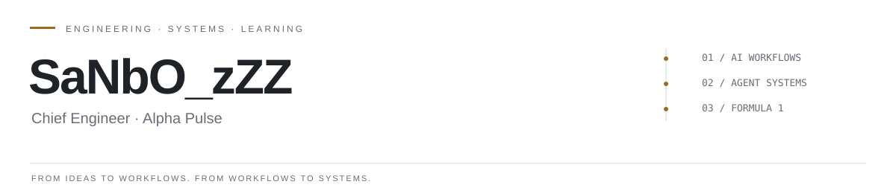

<picture>
  <source media="(prefers-color-scheme: dark)" srcset="assets/header-dark.svg">
  <source media="(prefers-color-scheme: light)" srcset="assets/header-light.svg">
  
</picture>

**Alpha Pulse 首席工程师 · AI 工作流构建者 · F1 内容创作者**  
**Chief Engineer at Alpha Pulse · AI Workflow Builder · F1 Creator**

我关注 AI 如何走出对话框，进入真实工作：把研究、判断、创作与交付连接成可验证、可复用、持续改进的系统。当前从 F1 视频制作出发，将一次次实践沉淀为代码、规则和工作流。

I build at the intersection of AI, workflow engineering and creative production. My focus is turning research, judgment and execution into systems that can be inspected, reused and improved. F1 video production is my current testing ground; the ambition extends across domains.

[cisco@alphapulsex.online](mailto:cisco@alphapulsex.online) · [F1 on Douyin / 抖音](https://v.douyin.com/MffNePCj08g/) · [Projects / 项目](https://github.com/SaNbO-zZZ?tab=repositories)

## Selected work / 代表项目

### [Work-Flow](https://github.com/SaNbO-zZZ/Work-Flow)

**从一个工作流，长出更多工作流。** 以 F1 Harness V1 的本机实践为起点，沉淀流程编排、人工审核、素材管理与交付方法，探索它们如何迁移到新的任务和领域。

**One workflow as a starting point for many.** A working collection of implementations, design decisions and reusable patterns, rooted in F1 Harness V1 and built to inform workflows beyond video production.

### [F1-Vedio-Agent](https://github.com/SaNbO-zZZ/F1-Vedio-Agent)

**把 F1 内容制作，组织成可审查的工程流程。** 内嵌于 Codex 的中文制片智能体，连接事实核验、脚本分镜、素材与声音、字幕和 MP4 交付，并以版本绑定的人工审核把关。

**An inspectable production workflow for F1 storytelling.** A Codex-native agent for Chinese-language F1 videos, connecting fact-checking, scripting, media sourcing, voiceover, subtitles and delivery through human review.

## Next questions / 下一阶段

我的下一步，是从“让 AI 完成一个任务”，走向“让多个 Agent 有效协作，并能证明这种协作带来了改进”。以下是正在学习和探索的方向：

My next step is to move from completing individual tasks with AI to understanding how multiple agents can collaborate—and how to measure whether that collaboration helps.

| Direction / 方向 | Questions I am exploring / 我在探索的问题 |
| --- | --- |
| **Workflow engineering / 工作流工程** | How can real tasks become reliable, recoverable workflows? / 如何让真实任务成为可靠、可恢复的工作流？ |
| **Multi-agent collaboration / 多 Agent 协作** | How should roles, parallel execution and shared context fit together? / 如何设计角色分工、并行执行与共享上下文？ |
| **Training & evaluation / 训练与评测** | How can collaborative training, feedback and evaluation improve agent systems? / 如何通过协同训练、反馈与评测改进 Agent 系统？ |
| **Memory & reuse / 经验与复用** | Which lessons should become reusable rules, tools and templates? / 哪些实践经验值得沉淀成规则、工具与模板？ |

这些是未来的探索方向；当前仓库记录已经落地的工作流与工程实践。  
These are directions for continued study; the repositories document the workflow implementations built so far.

## Background / 背景

我的起点是社会学、全球研究与品牌洞察。它们让我习惯先理解人、情境和系统，再选择工具与实现路径。现在，我把这套视角带入 Alpha Pulse 的工程工作和自己的内容实践。

My background in sociology, global studies and consumer insight shapes how I approach engineering: understand the people, the context and the system before choosing the tools. I bring that perspective to my work at Alpha Pulse and to my own creative practice.

| Experience / 经历 | Focus / 重点 |
| --- | --- |
| **Alpha Pulse · Present / 现任** | Chief Engineer / 首席工程师 |
| **P&G China / 宝洁中国 · 2026** | Brand Growth internship; consumer insight, brand positioning and communications strategy / 品牌增长实习，消费者洞察、品牌定位与传播策略 |
| **Songdu Group / 宋都集团 · 2019** | Project Management internship; stakeholder coordination and delivery risk / 项目管理实习，多方协同与交付风险管理 |
| **Northeastern University / 美国东北大学 · 2024–2026** | Master's degree in Global Studies / International Relations / 全球研究、国际关系硕士 |
| **University of California, Irvine / 加州大学欧文分校 · 2018–2023** | Bachelor's degree in Sociology / 社会学学士 |

**Research & analysis / 研究与分析：** R / RStudio · SPSS · NVivo · English & Chinese / 中英双语

---

**Build from real work. Learn through evidence. Make the next workflow better.**  
**从真实工作出发，用证据校准，让下一个工作流更好。**
